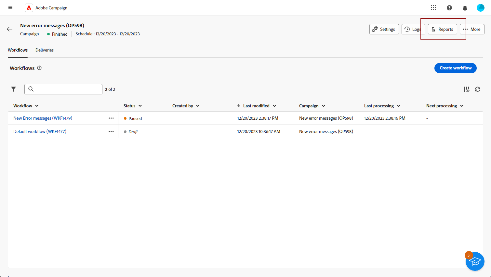
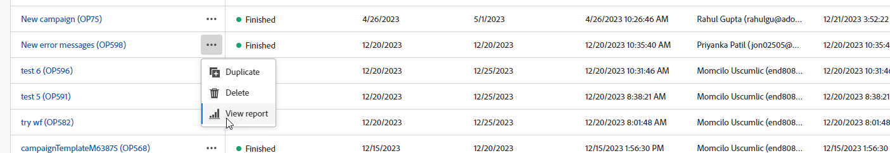
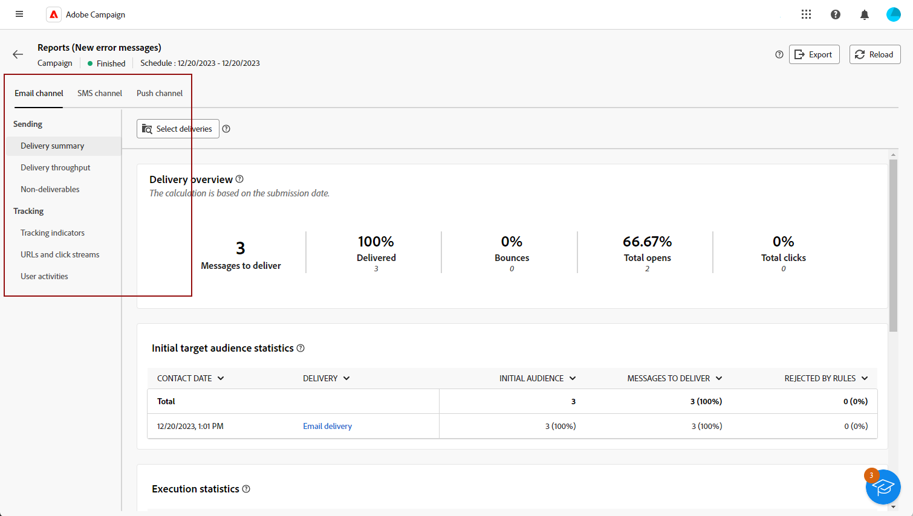
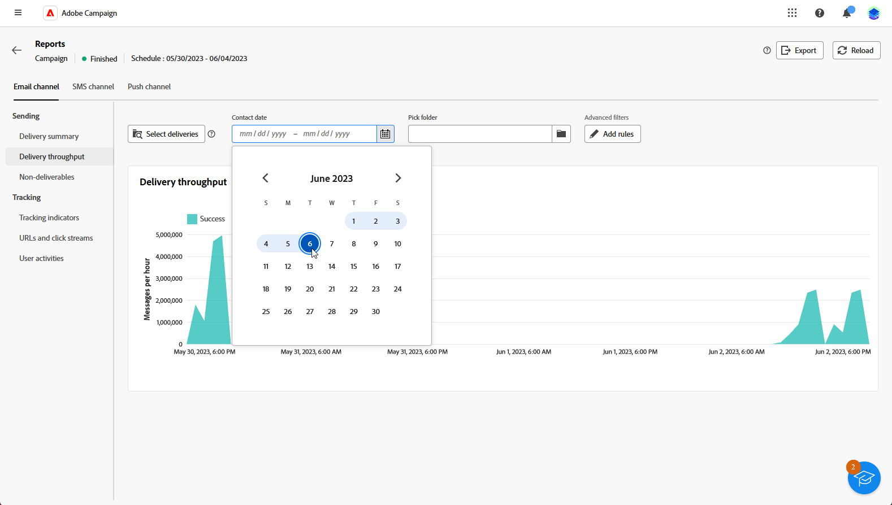

# Introducción a los informes de campaña {#campaign-reports}

Los **informes de campaña** ofrecen una descripción general completa de la **campaña**, que incluye toda la información pertinente sobre los distintos envíos incluidos. Estos informes ofrecen un análisis detallado del rendimiento de cada envío por canal, incluidas las tasas de éxito, la participación de la audiencia y otras métricas clave. Le ayudan a evaluar la eficacia y el impacto generales de su campaña.

La lista completa de informes y las métricas asociadas para cada canal se encuentran disponibles en las siguientes páginas:

* [Canal de campaña de correo electrónico](campaign-reports-email.md)
* [Canal de campaña de SMS](campaign-reports-sms.md)
* [Canal de campaña push](campaign-reports-push.md)
* [Canal de campaña de correo directo](campaign-reports-direct-mail.md)

## Administrar el tablero de informes {#manage-reports}

Para acceder y administrar los informes de campaña, siga estos pasos:

1. Vaya al menú **[!UICONTROL Campañas]** y haga clic en el botón **Informes** del panel de campañas.

   {zoomable="yes"}

   También puede usar el botón de tres puntos **Más acciones** junto al nombre de la campaña en la lista de campañas y seleccionar **[!UICONTROL Ver informe]**.

   {zoomable="yes"}

1. En el menú de la izquierda, seleccione un informe de la lista y navegue por las pestañas para mostrar los datos de cada canal.

   {zoomable="yes"}

1. En el tablero, haga clic en **[!UICONTROL Seleccionar entregas]** para segmentar una entrega específica incluida en la campaña.

1. En el menú **[!UICONTROL Rendimiento de entrega]**, elija un **Inicio** y **[!UICONTROL Hora de finalización]** para centrarse en datos específicos.

   {zoomable="yes"}

1. En el campo **[!UICONTROL Seleccionar carpeta]**, seleccione si desea segmentar envíos o campañas desde una carpeta específica.

   También puede seleccionar **[!UICONTROL Agregar reglas]** para generar consultas a fin de filtrar mejor los datos de los informes. [Aprenda a utilizar el modelador de consultas](../query/query-modeler-overview.md)

   {zoomable="yes"}

1. Entre las **[!UICONTROL URL y los flujos de clics]**, elija los **[!UICONTROL vínculos más visitados]** o el **[!UICONTROL período de tiempo]**.

   Las opciones de **[!UICONTROL Ver por]** permiten filtrar por direcciones URL, etiquetas o categorías.

## Informes del canal LINE {#line-reports}

A continuación, se describen los informes disponibles para el canal LINE.

### Resumen de entregas {#line-delivery-summary}

>[!CONTEXTUALHELP]
>id="acw_campaign_reporting_line_deliveries_overview"
>title="Información general sobre el envío"
>abstract="Ver mensajes para enviar, mensajes enviados y errores de entrega para LINE."

El informe **[!UICONTROL Resumen de entrega]** muestra los mensajes que se van a enviar, los mensajes enviados y los errores de entrega de los envíos de LINE.

#### Estadísticas de público destinatario inicial {#line-initial-target}

>[!CONTEXTUALHELP]
>id="acw_campaign_reporting_line_target"
>title="Estadísticas de público destinatario inicial"
>abstract="Revise la población de destinatarios inicial y los perfiles excluidos antes de ejecutar la entrega LINE."

La tabla **[!UICONTROL Estadísticas de audiencia de destinatario inicial]** muestra la población de destinatarios inicial y los perfiles excluidos antes de que se ejecutara la entrega LINE.

#### Estadísticas de ejecución {#line-exec-stats}

>[!CONTEXTUALHELP]
>id="acw_campaign_reporting_line_exec_stats"
>title="Estadísticas de ejecución"
>abstract="Revise los resultados de procesamiento y entrega de los mensajes de LINE, incluidos los mensajes enviados y los errores."

La tabla **[!UICONTROL Execution statistics]** muestra los resultados de procesamiento y envío de los mensajes de LINE, incluidos los mensajes enviados y los errores.

#### Flujos de clics generados {#line-click-streams}

>[!CONTEXTUALHELP]
>id="acw_campaign_reporting_line_click_streams"
>title="Flujos de clics generados"
>abstract="Vea la actividad de vínculo rastreado generada por los destinatarios de la entrega LINE."

La tabla **[!UICONTROL Flujos de clics generados]** muestra la actividad de vínculos rastreados generada por los destinatarios de la entrega LINE.
